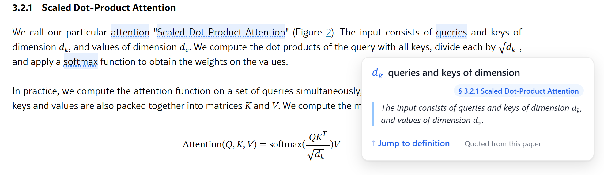
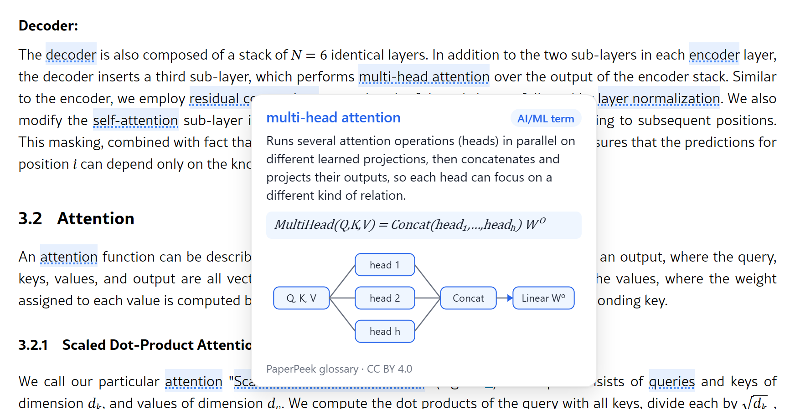
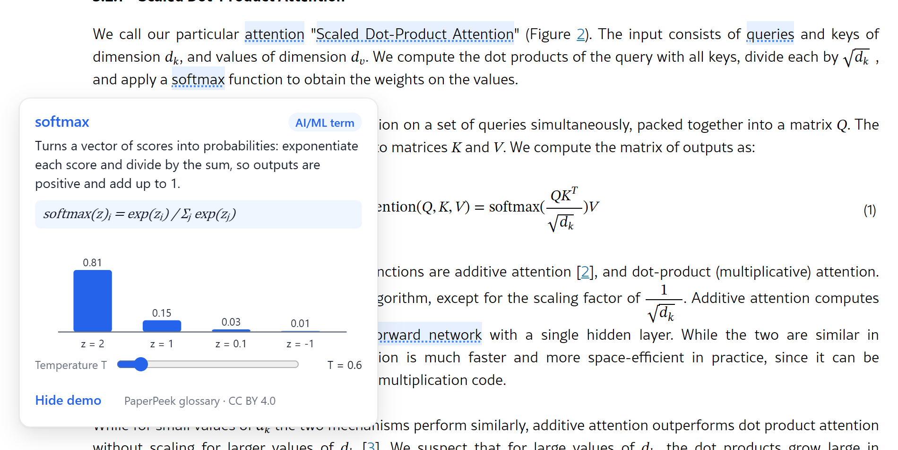
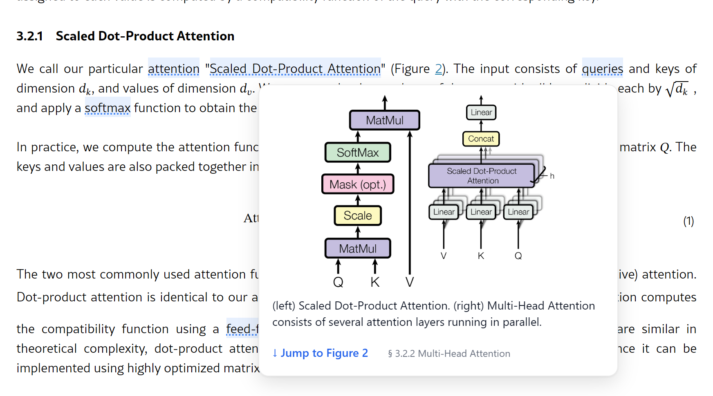
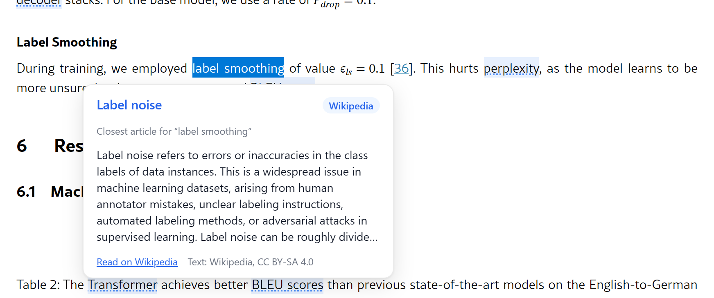

# PaperPeek

**Hover any symbol, AI/ML term or figure in a paper and see what it means, right where you are reading.**

[Website](https://blakc-coffee.github.io/paperpeek/) · [Privacy policy](https://blakc-coffee.github.io/paperpeek/privacy.html) · [Accuracy on SymDef](docs/eval.md) · [Performance](docs/performance.md)



## Features

- **Symbols.** Hover `d_k` to see the sentence that defined it, its section, and a jump link. When a symbol is redefined, you get the definition that applies at your position.
- **AI/ML terms.** Key terms are underlined. Hover one for a plain explanation, the formula, and a diagram.
- **Interactive demos.** Some terms have a **▶ Try it** button: softmax temperature, activation functions, a toy attention heatmap, gradient descent, dropout, and next-token sampling (temperature, top-k, top-p).
- **Figures and tables.** Hover a "Figure 2" or "Table 1" reference to preview it without scrolling away.
- **Look anything up.** Select a word or phrase. A bundled glossary of 459 terms answers offline. For anything else you can do an opt-in Wikipedia lookup, which sends only that term.
- **Keyboard.** Select text with Shift+arrow keys to look it up, or press **Alt+Shift+P** to explain the symbol, figure reference or term at the caret.

| | |
|---|---|
|  |  |
|  |  |

## Where it works

- **arXiv HTML** (`arxiv.org/html/…`) and **ar5iv**. These work out of the box, with symbols, terms, figures and demos.
- **Any other site you enable** from the toolbar button: Wikipedia, blogs, GitHub, and others. On these sites you get terms, demos and lookups.
  - Symbol definitions work wherever formulas are native MathML, as on Wikipedia.
  - On KaTeX and MathJax blogs, hovering a formula lists each of its symbols with its definition.
- **arXiv abstract pages, Hugging Face Papers and alphaXiv.** These show a link to open the paper's arXiv HTML version.

## Install from source

```powershell
pnpm install
pnpm build
```

Then load it in Chrome:

1. Open `chrome://extensions`.
2. Turn on **Developer mode**.
3. Click **Load unpacked** and select `.output/chrome-mv3`.
4. Open [arxiv.org/html/1706.03762](https://arxiv.org/html/1706.03762) and hover a formula.

To check your changes, run `pnpm test` for the unit tests. `pnpm e2e` loads the build into headless Chrome and checks it on a real arXiv paper.

## Privacy

- No account, telemetry, server or AI model; everything runs in your browser.
- The extension runs only on arXiv HTML and the sites you enable.
- The only network request is the Wikipedia lookup. It is off unless you allow it, and it sends just the selected term.

## Credits and license

The idea of position-aware symbol definitions comes from [ScholarPhi](https://arxiv.org/abs/2009.14237) (Head et al., CHI 2021).

Code is under the [MIT](LICENSE) license. Glossary data in [`data/glossary/`](data/glossary/) records its source and license on every entry and shows them in the popup:

| Data | Source | License |
|---|---|---|
| `core.json`, `diagrams.ts` | Written for PaperPeek | CC BY 4.0 |
| `generated.json` | [Aalto Dictionary of Machine Learning](https://github.com/AaltoDictionaryofML/AaltoDictionaryofML.github.io), Alexander Jung and contributors (first sentences, LaTeX converted to text) | CC BY 4.0 |
| `generated.json` | [Wikidata](https://www.wikidata.org/) | CC0 |

Wikipedia text shown in lookups is CC BY-SA 4.0 and credited in the popup.
