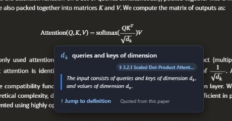
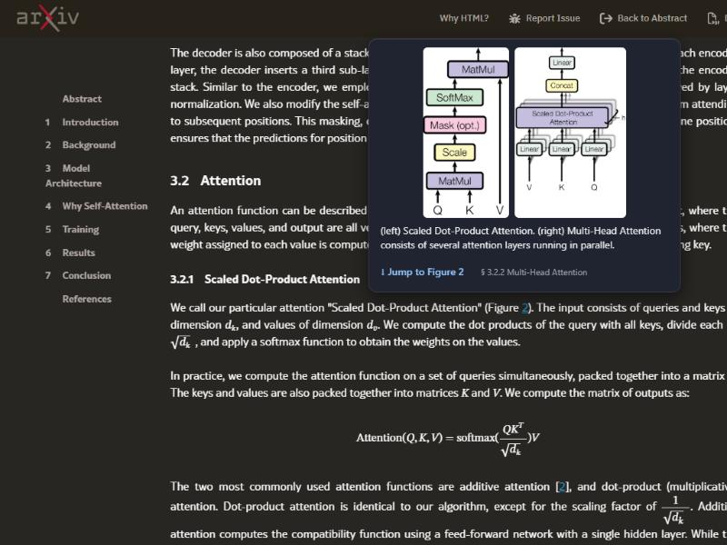
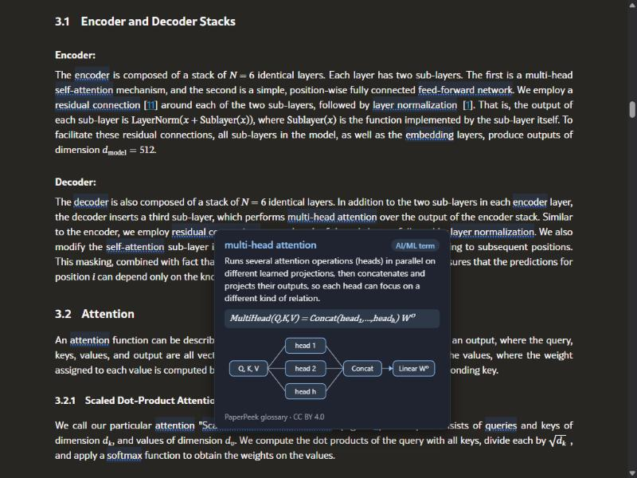
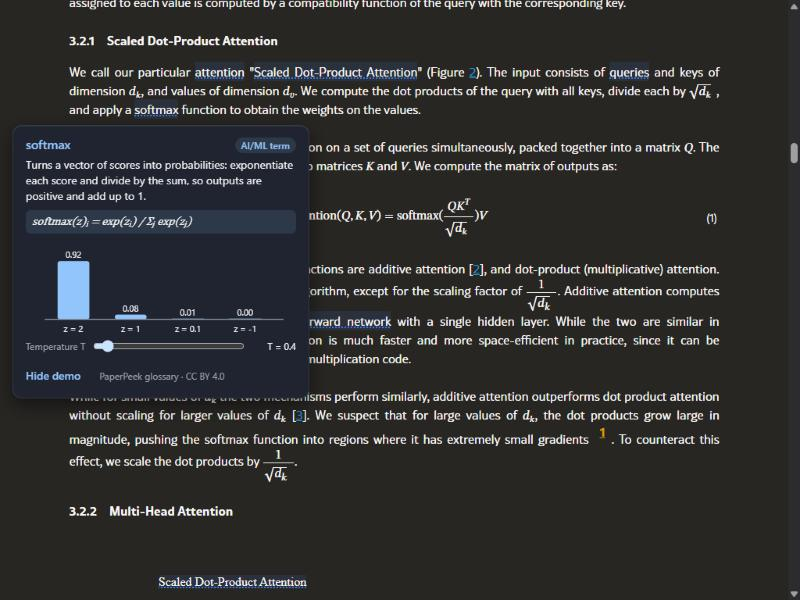
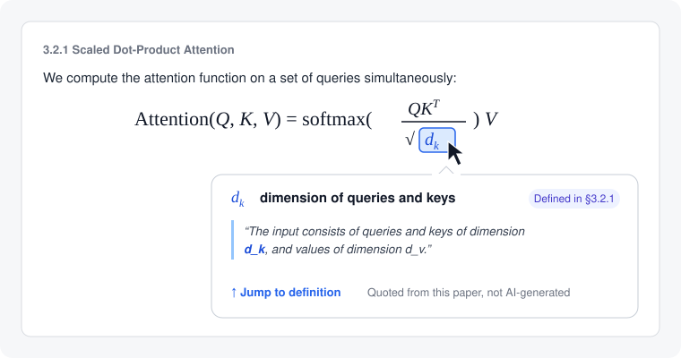
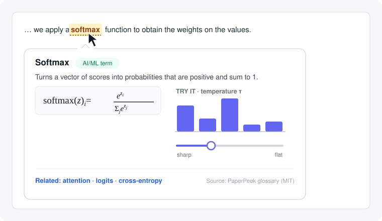
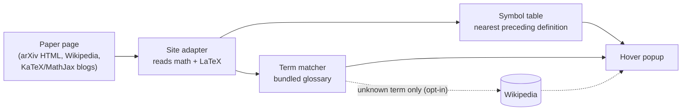

# PaperPeek

**Hover any symbol, AI/ML term or figure in a paper and see what it means — where it was defined, with diagrams, the paper's own figures, and small interactive demos.**

Reading ML papers means constantly scrolling back to find where `𝓛`, `W^Q` or `λ` was introduced four pages ago, or googling "KL divergence" for the tenth time. PaperPeek is a browser extension that answers both in place:

- **Symbols** — hover `d_k` and see the sentence that defined it, the section it belongs to, and a link to jump there. When a symbol is redefined, you get the definition that applies *at your position* (nearest preceding definition).
- **AI/ML terms** — hover "multi-head attention" and get a short explanation, its formula, a diagram, and (for some terms) a mini demo such as a softmax-temperature slider.
- **Figures** — hover "Figure 2" and see the figure with its caption without losing your place.

## What it looks like

**Real screenshot (v0.2)** — hovering `d_k` in *Attention Is All You Need* on arxiv.org, following arXiv's dark theme:



**Real screenshot (v0.3)** — hovering the "Figure 2" link in §3.2.1 previews the figure and its caption without scrolling away:



**Real screenshot (v0.4)** — AI/ML terms are tinted and underlined (first use per section); hovering "multi-head attention" shows a plain explanation, the formula, and a diagram:



**Real screenshot (v0.5)** — terms with a ▶ **Try it** button open a small interactive demo; here the softmax temperature slider at T = 0.4:



Five demos ship today: **softmax temperature**, **activation functions** (ReLU / GELU / sigmoid at any x), **toy self-attention heatmap** (score-scale slider), **gradient descent on x²** (learning-rate slider, shows divergence above η = 1), and **dropout** (drop-rate slider + resample).

> The images below are the original design mockups.

**Hover a symbol** → its definition, quoted from the paper, with a jump link:



**Hover an AI/ML term** → plain-language explanation, formula, and a mini demo:



## Examples

What PaperPeek shows when you hover these on [arxiv.org/html/1706.03762](https://arxiv.org/html/1706.03762) (*Attention Is All You Need*):

| You hover | Kind | Popup shows |
|---|---|---|
| `d_k` in the attention formula | Symbol | "dimension of queries and keys" · the sentence that introduced it (§3.2.1) · jump link |
| `W_i^Q` in multi-head attention | Symbol | "projection matrix for queries, head *i*" · its shape `d_model × d_k` as written in the paper |
| `h` | Symbol | "number of parallel attention heads" · the value used in the paper (8) |
| "multi-head attention" | AI/ML term | short explanation · formula · diagram of heads being concatenated |
| "residual connection" | AI/ML term | explanation · `y = x + F(x)` · skip-connection diagram |
| "softmax" | AI/ML term | explanation · formula · scores → probabilities diagram · ▶ Try it: temperature slider |
| "Figure 2" link | Figure | both diagram panels and the caption, inline · jump link |
| "Table 1" link | Table | the table (scrollable, with its math) and caption · jump link |
| "label smoothing" (not in the bundled glossary) | AI/ML term | Wikipedia summary + thumbnail, with CC BY-SA credit (opt-in) |

## How it works



Everything runs in your browser. arXiv's HTML papers already contain each formula's LaTeX, so no OCR or AI model is needed. Full design and research: [`docs/architecture.md`](docs/architecture.md).

## Principles

- **Local-first & private.** No account, no telemetry, no AI model, no server. The only network call is an opt-in Wikipedia lookup for unknown terms, which sends just the term.
- **Deterministic.** Definitions come from the paper itself and from a curated, licensed glossary — every popup shows its source.
- **Light.** Vanilla TypeScript, lazy-loaded popup, ~30 MB per tab budget. Runs only on sites you enable.

## Where it works

| Phase | Sites |
|---|---|
| 1 | arXiv HTML (`arxiv.org/html/…`), ar5iv |
| 2 | Wikipedia, GitHub READMEs, KaTeX / MathJax blogs, Hugging Face Papers, alphaXiv & OpenReview (via arXiv resolver) |
| Later (opt-in) | PDFs through a bundled pdf.js viewer |

## Status

🚧 **Early development.** On arXiv HTML pages, hovering a symbol shows where it was defined (v0.2), hovering a Figure or Table reference previews it (v0.3), 71 AI/ML terms are highlighted with explanation popups (v0.4), and five of them open interactive demos (v0.5). See [`docs/architecture.md`](docs/architecture.md) for the research, the architecture decision, and the milestone roadmap (v0.0 → v1.0).

### Try the current build

```powershell
pnpm install
pnpm build
```

Chrome → `chrome://extensions` → enable **Developer mode** → **Load unpacked** → select `.output/chrome-mv3`. Open [arxiv.org/html/1706.03762](https://arxiv.org/html/1706.03762) and hover any symbol in a formula (e.g. `d_k`, `h`, `N`) or a figure/table reference (e.g. "Figure 2" in §3.2.1).

## Roadmap

- [x] v0.0 Repo foundation (docs, WXT scaffold, CI, release automation)
- [x] v0.1 arXiv symbol table + definition detection
- [x] v0.2 Hover popup
- [x] v0.3 Figure previews
- [x] v0.4 ML term glossary + highlighting
- [x] v0.5 Interactive demos
- [ ] v0.6 Wikipedia fallback (opt-in)
- [ ] v0.7 Glossary build pipeline
- [ ] v0.8 Multi-site adapters
- [ ] v0.9 Evaluation on SymDef
- [ ] v1.0 Chrome Web Store + Firefox Add-ons release

## Prior art

PaperPeek builds on ideas from [ScholarPhi](https://arxiv.org/abs/2009.14237) (Head et al., CHI 2021), which showed position-sensitive symbol definitions were the most-used reading aid in its user study.

## License

Code: [MIT](LICENSE). The bundled glossary in [`data/glossary/`](data/glossary/) (text and diagrams written for PaperPeek) is CC BY 4.0; later sources will carry their own license per entry.
