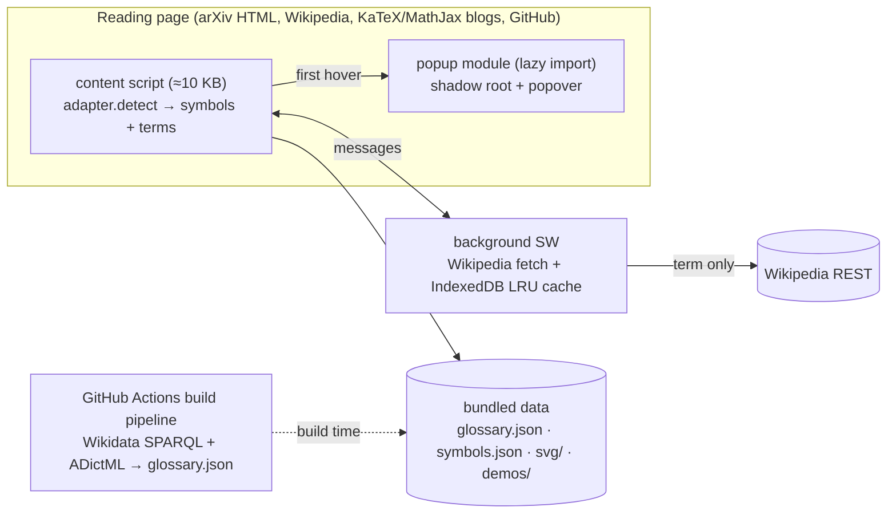

# PaperPeek — Architecture & Roadmap

## Context
Readers of ML/STEM papers lose track of author-defined notation (𝓛, **W**, λ) and jargon (attention, KL divergence). PaperPeek is a browser extension with hover popups:
- **Symbols**: where the symbol was defined, which definition applies at this position, and its section.
- **AI/ML terms**: a short explanation, a diagram, the paper's own figure, and an optional mini interactive demo.

It starts on arXiv and expands to other reading sites. The user wants:
- the cheapest, lowest-memory architecture;
- a repo pushed to GitHub slowly, in small steps;
- the user only reviews.

This plan was built from four deep-research tracks (reading-site math formats, extension architecture, knowledge sources and licenses, prior art) followed by a three-stage council deliberation.

---

## 1. Research findings that drive the design

**Sites and math formats**
- **arXiv HTML (LaTeXML) is the ideal source** (checked live).
  - Each formula is `<math class="ltx_Math" alttext="h_{t}">` containing `mi`/`mo`/`mn` tokens and `<annotation encoding="application/x-tex">`.
  - Ids are stable: `S3.p1.m2`, `#S3.F1` for figures, `#S3.SS2` for subsections, and `a.ltx_ref` for references.
  - No OCR or KaTeX parsing is needed.
  - About 75% of the corpus converts without errors, so pages with `.ltx_ERROR` need a fallback.
- **An arXiv-id resolver covers most traffic.** alphaXiv, Hugging Face Papers, many OpenReview/ACL papers, old Papers-with-Code links (PwC shut down July 2025 and now redirects to HF) and arXiv PDFs can all be mapped to `arxiv.org/html/<id>`.
- **Other renderers expose the LaTeX source cheaply:**
  - KaTeX: `.katex-mathml annotation`
  - Wikipedia: `data-mw` JSON field `body.extsrc`
  - GitHub: `<math-renderer>` keeps the raw `$…$`
  - MathJax v2: `script[type=math/tex]`
  - MathJax v3/v4: needs a small page-context (`world:'MAIN'`) script that reads `MathJax.startup.document.math`
- **PDFs:**
  - Chrome's built-in PDF viewer cannot be scripted by extensions.
  - Chrome 151 adds `chrome.mimeHandler` for replacing the PDF viewer; a `declarativeNetRequest` redirect to a bundled pdf.js viewer is the fallback.
  - The pdf.js text layer yields glyphs without math structure, so PDFs are a late, opt-in milestone.

**Extension architecture**
- **WXT** is the only actively maintained cross-browser framework (Plasmo is in maintenance mode). It is build-time only, generates Chrome and Firefox builds, and handles zip and store submission.
- **Rendering primitives:**
  - Native `popover` (Baseline 2025), MathML Core (Chrome 109+, Firefox), CSS anchor positioning (Firefox 147+, partial).
  - Custom Highlight API: about 3× faster than wrapping matches in ``s, and it doesn't mutate the page.
- **Permissions:** `activeTab` plus `optional_host_permissions`, with `registerContentScripts` per site the user enables. This avoids slow Chrome Web Store reviews for "all sites" access and keeps the extension idle on every other site.

**Knowledge sources** (bundle what the license allows; fetch nothing at runtime except Wikipedia)

| Source | License | Use |
|---|---|---|
| Own definitions and SVGs | MIT / CC BY 4.0 | Core |
| Aalto Dictionary of ML (567 terms) | CC BY 4.0 | Bundle, with attribution |
| Google ML Glossary (text only) | CC BY 4.0, images excluded | Bundle text |
| bfortuner ml-glossary, afshinea CS229 cheatsheets | MIT | Bundle |
| Wikidata labels and descriptions | CC0 | Pull at build time via SPARQL |
| Wikipedia REST `page/summary` | CC BY-SA, images licensed per file | Runtime fallback only |
| Goodfellow book, NIST DLMF | Not reusable | Do not use |

- Wikipedia's 2026 rate limits are 200 requests/min for browser traffic. Send an `Api-User-Agent` header, cache responses, and send only the term itself.
- Chrome's built-in Gemini Nano needs 16 GB RAM or more than 4 GB of VRAM, so it is not a dependency.

**Prior art and the gap**
- **ScholarPhi** (CHI 2021, Apache-2.0):
  - Symbol tooltips were the feature readers used most (a median of 10 opens per reader; 96% used at least one feature).
  - Rule: show the **nearest preceding definition**.
  - It needed LaTeX recompilation and a server, and is no longer in production.
- **Semantic Reader:** AI-generated definitions of words, arXiv only.
- **Moonlight, SciSpace, alphaXiv:** cloud LLM "explain the selection" tools, mostly paid.
- **Google Scholar PDF Reader:** figure and citation popups, but no symbols.
- **The gap:** nobody ships deterministic, offline, scope-aware symbol tracking that works across sites. The dictionary-first approach is also faster: a 2026 study measured 2.1 s for dictionary lookups vs 16.4 s for LLM-generated definitions.
- **SymDef/TaDDEx** (21 ML papers with every symbol linked to its definition) can serve as an evaluation set.

---

## 2. Council

### Stage 1: three alternatives
- **A. Pure client extension.** WXT with vanilla TypeScript, per-site adapters, deterministic symbol table and definition patterns, a bundled glossary, and a cached Wikipedia fallback. No server, no model.
- **B. Extension plus a local companion.** Native messaging to a Python helper running Pix2Text OCR for PDFs, a TaDDEx definition model, and Ollama for unknown terms.
- **C. Precompute in the cloud (ScholarPhi-style).** GitHub Actions processes arXiv LaTeX sources into symbol-table JSON hosted on GitHub Pages; the extension only fetches and displays.

### Stage 2: adversarial critique
- **A:** Pattern-based definition detection misses implicit definitions ("…, respectively"). PDFs are weak. *Defence:* arXiv HTML already carries structure, and the nearest-preceding-occurrence fallback still answers "where did this appear first".
- **B:** Uses 1–3 GB of RAM while running, needs a Python install per user, a native-messaging host is fragile on Windows, and it can't ship on the Chrome Web Store alone. Demo risk is high.
- **C:** Covers arXiv only, sends every paper id you read to a server (a privacy leak), keeps Actions minutes busy, and duplicates work the arXiv HTML already did.

| Criterion (weight) | A | B | C |
|---|---|---|---|
| Correctness on arXiv (25) | 8 | 9 | 9 |
| RAM / latency (20) | 10 | 4 | 9 |
| Privacy (15) | 10 | 10 | 5 |
| Build effort for a solo student (15) | 9 | 3 | 5 |
| Multi-site reach (15) | 9 | 8 | 2 |
| Demo-ability / novelty (10) | 8 | 9 | 7 |
| **Weighted score (out of 10)** | **9.0** | **6.9** | **6.5** |

### Stage 3: the blueprint
**A wins.** It borrows two things:
- From **C**, the *build-time* data pipeline: GitHub Actions turns Wikidata, ADictML and other sources into the bundled glossary JSON. There are no runtime servers.
- From **B**, an *optional, late* local OCR helper for non-arXiv PDFs. It is a post-1.0 stretch goal and never a hard dependency.

---

## 3. Final architecture

### Core modules (`src/core`, pure TypeScript, unit-tested without a browser)
| Module | Responsibility |
|---|---|
| `tex-tokens.ts` | Tokenize a LaTeX string into symbol keys (`\mathcal{L}`, `W^{Q}`, `\lambda`) and normalize variants (`\mathbf{W}` ≡ `𝐖`). |
| `symbol-table.ts` | Map each symbol key to its occurrences `{pos, sectionId, sentence}`. `lookup(key, pos)` returns the **nearest preceding definition** (the ScholarPhi rule), else the first occurrence. Redefinitions are tracked per section. |
| `definitions.ts` | Deterministic definition patterns: `where X is/denotes`, `let X be`, `X denotes`, `X, Y and Z are … respectively`, and `X (the …)`. Each match is scored by confidence, and the source sentence is always shown. |
| `term-matcher.ts` | A single regex alternation compiled from the glossary (longest match first, word boundaries, aliases). Switch to Aho-Corasick only if the glossary grows past about 2k terms. |

### Site adapters (`src/adapters`)
Each adapter implements one interface: `match(url)`, `mathNodes(root)`, `texOf(node)`, `sections(root)`, `figures(root)`.
- **Phase 1:** `arxiv-html` (also ar5iv).
- **Phase 2:** `katex`, `wikipedia`, `github`, `mathjax2`.
- **Phase 2:** `mathjax3`/`mathjax4` via a `world:'MAIN'` bridge.
- **Fallback:** `generic`, which matches terms only.

The `resolver.ts` maps alphaXiv, HF Papers, OpenReview, ACL and arxiv/pdf pages to an "Open in arXiv HTML with PaperPeek" action.

### UI (`src/ui`, vanilla TS, no framework)
- **One popup element per tab:** a shadow-root host plus `popover="manual"`.
  - Positioned with JS rect math, plus CSS anchor positioning where supported.
  - Opens after a 120 ms hover-intent delay. Esc or a click outside closes it; clicking pins it.
- **Popup sections:** title · definition sentence (cloned MathML) · section badge with a "jump to definition" link · glossary text · formula (native MathML) · diagram SVG or the paper figure with its caption · demo button.
- **Hover detection:**
  - Math tokens are real elements, so one delegated `pointerover` listener handles them.
  - Terms are painted with the **Custom Highlight API** and hit-tested via `caretPositionFromPoint` plus a sorted per-node range lookup.
- **Demos** (`src/ui/demos/`) are inline SVG with `<input type=range>`, rendered only when opened: softmax temperature, activation functions, a toy attention heatmap, gradient descent on a bowl, and dropout.

### Data (`data/`, one folder per source, each with its own `LICENSE` and `attribution` fields)
- `glossary/core.json`: hand-written entries plus about 20 own SVGs.
- `glossary/adictml.json` (CC BY 4.0) and `glossary/wikidata.json` (CC0): both generated by `scripts/build-glossary.ts`.
- `symbols.json`: about 80 notation conventions written by hand (θ, λ, η, ∇, 𝔼, ‖·‖₂, σ…).

### Memory and cost budget
- Content script ≈10 KB plus glossary ≈300–800 KB, loaded only on enabled sites. The popup module loads lazily.
- Target: under 30 MB extra per tab, setup under 150 ms on a 30-page paper, popup open under 50 ms.
- No model, no server, no telemetry.
- Total cost: **$5 one-time** Chrome Web Store fee; Firefox Add-ons (AMO), Edge and GitHub Actions on a public repo are free.

---

## 4. GitHub repo plan (small steps, one PR each)

**Repo:** `github.com/blakc-coffee/paperpeek`, public, MIT for code, per-source licenses under `data/`. Before creating it, check the name for clashes on the Chrome Web Store and GitHub.

**Conventions:**
- Conventional commits; `main` is protected; one feature branch → one PR → squash merge.
- release-please opens version PRs, and every milestone becomes a GitHub Release with zips for both browsers attached.

| Milestone | PRs (each small and reviewable) | Done when |
|---|---|---|
| **v0.0 Repo foundation** | (1) README with problem, demo GIF placeholder section and roadmap; LICENSE; `.gitignore`; `docs/architecture.md` (this plan). (2) WXT scaffold, vanilla TS, empty content script. (3) CI: typecheck, vitest, `wxt build`, `web-ext lint`. (4) release-please. | Green CI and an empty extension that loads in Chrome and Firefox |
| **v0.1 arXiv symbols** | `tex-tokens` with tests · `arxiv-html` adapter · `symbol-table` + `definitions` with fixtures (Attention Is All You Need, LoRA, DDPM) | Unit tests pass; the console prints the symbol table on arxiv.org/html/1706.03762 |
| **v0.2 Popup** | Shadow-root popover · hover delegation on `mi` · definition sentence and jump link · light/dark tokens | Hovering `d_k` shows its definition sentence |
| **v0.3 Figures** | Figure index · `ltx_ref` hover preview · figure shown when a definition sentence references one | Hovering "Figure 2" shows the image and caption |
| **v0.4 ML terms** | `core.json` (60 terms) + SVGs · term-matcher · Custom Highlight painting and hit-testing | "multi-head attention" shows text, formula and diagram |
| **v0.5 Demos** | One PR per demo (5) | Sliders work inside the popup |
| **v0.6 Wikipedia fallback** | Service worker fetch with `Api-User-Agent` · IndexedDB LRU with 7-day TTL · attribution footer · opt-in toggle in options | Unknown term shows a summary and thumbnail with CC BY-SA credit |
| **v0.7 Glossary pipeline** | `scripts/build-glossary.ts` (Wikidata SPARQL + ADictML) · scheduled monthly Action that opens a PR with diffs | About 500 terms bundled, licenses tracked per entry |
| **v0.8 Multi-site** | Permissions flow (`optional_host_permissions` + `registerContentScripts`) · adapters for KaTeX, Wikipedia, GitHub, MathJax v2 and v3/v4 · arXiv-id resolver | Works on lilianweng.github.io, en.wikipedia.org, a GitHub README and an HF Papers page via the resolver |
| **v0.9 Evaluation** | Run the definition linker against SymDef (after checking its license) · publish precision/recall in `docs/eval.md` | Baseline numbers in the README |
| **v1.0 Store release** | Store assets, privacy policy ("no data collected"), `wxt submit` workflow with `STAGED_PUBLISH` | Live on the Chrome Web Store and AMO |
| **Post-1.0 (optional)** | pdf.js viewer via `mimeHandler` / DNR redirect · local Pix2Text OCR helper for non-arXiv PDFs | Opt-in only |

**Status:** v0.0 PR 1 (this document, README, LICENSE) is the first commit.

---

## 5. Top risks and mitigations
1. **Definition patterns miss implicit definitions.**
   - Always show the source sentence plus "first used here", so a miss still helps.
   - Measure against SymDef (v0.9) and add patterns driven by the data.
2. **Site DOMs change** (MathJax v4, Wikipedia markup).
   - Adapters stay isolated, each with a saved HTML fixture test.
   - The generic adapter degrades to terms only.
3. **Licensing mistakes in bundled data.**
   - A per-entry `license`/`source` field, plus a CI check that rejects entries without one.
   - No images except our own SVGs and Commons files explicitly marked CC0/CC BY.

## 6. Verification (for each milestone)
- `pnpm test`: vitest on the core modules with saved HTML fixtures.
- `pnpm build && npx web-ext lint`.
- Manual: load the unpacked extension in Chrome and Firefox and walk through the "Done when" column on the named pages.
- Performance: Chrome Task Manager memory under 30 MB per tab; the DevTools Performance setup pass under 150 ms.
